# BÁO CÁO THỰC HÀNH KIỂM THỬ API VỚI POSTMAN (LAB 7)

**TRƯỜNG ĐẠI HỌC PHENIKAA — KHOA CÔNG NGHỆ THÔNG TIN**  
**MÔN HỌC:** ĐẢM BẢO VÀ KIỂM ĐỊNH CHẤT LƯỢNG PHẦN MỀM  
**MÃ LỚP HỌC PHẦN:** CSE703010-1-1-26 (COUR01.LT2)  

---

## 📌 THÔNG TIN SINH VIÊN
* **Họ và tên:** **Đàm Quang Đô**
* **Mã sinh viên (MSSV):** **23010046**
* **Lớp:** K17 CNTT - Đại học Phenikaa
* **Email sinh viên:** `23010046@st.phenikaa-uni.edu.vn`
* **Tài khoản GitHub:** [`Dooty26`](https://github.com/Dooty26)
* **Repository bài tập:** [Postman-API-Testing](https://github.com/Dooty26/Postman-API-Testing)
* **Ngày thực hiện:** 07/10/2026

---

## 📑 MỤC LỤC
1. [Mục tiêu kiểm thử](#1-mục-tiêu-kiểm-thử)
2. [Tài liệu nghiên cứu & Tham khảo](#2-tài-liệu-nghiên-cứu--tham-khảo)
3. [Tổng quan về công cụ Postman](#3-tổng-quan-về-công-cụ-postman)
4. [Cấu hình môi trường kiểm thử (Environment)](#4-cấu-hình-môi-trường-kiểm-thử-environment)
5. [Ma trận kịch bản kiểm thử (Test Matrix)](#5-ma-trận-kịch-bản-kiểm-thử-test-matrix)
6. [Chi tiết thực hiện các kịch bản kiểm thử (Kèm hình ảnh minh họa)](#6-chi-tiết-thực-hiện-các-kịch-bản-kiểm-thử)
   - [TC01: GET - Lấy danh sách toàn bộ bài viết](#tc01-get---lấy-danh-sách-toàn-bộ-bài-viết)
   - [TC02: GET - Lấy chi tiết bài viết theo ID](#tc02-get---lấy-chi-tiết-bài-viết-theo-id)
   - [TC03: POST - Tạo bài viết mới](#tc03-post---tạo-bài-viết-mới)
   - [TC04: PUT - Cập nhật toàn bộ bài viết](#tc04-put---cập-nhật-toàn-bộ-bài-viết)
   - [TC05: PATCH - Cập nhật một phần bài viết](#tc05-patch---cập-nhật-một-phần-bài-viết)
   - [TC06: DELETE - Xóa bài viết](#tc06-delete---xóa-bài-viết)
   - [TC07: GET - Lọc danh sách bình luận (Query Params)](#tc07-get---lọc-danh-sách-bình-luận-query-params)
   - [TC08: GET - Negative Case: ID không tồn tại (404)](#tc08-get---negative-case-id-không-tồn-tại-404)
7. [Kết quả kiểm thử tự động với Collection Runner & Newman](#7-kết-quả-kiểm-thử-tự-động-với-collection-runner--newman)
8. [Đánh giá kết quả & Báo cáo lỗi (Defect Report)](#8-đánh-giá-kết-quả--báo-cáo-lỗi-defect-report)
9. [Hướng dẫn Import và Chạy thử nghiệm](#9-hướng-dẫn-import-và-chạy-thử-nghiệm)

---

## 1. MỤC TIÊU KIỂM THỬ
* **Nắm vững nguyên lý kiểm thử API & giao thức HTTP:** Hiểu rõ cấu trúc Request (Method, Headers, Parameters, Body) và Response (Status Code, Headers, Response Body JSON, Response Time).
* **Làm chủ công cụ Postman:** Thành thạo tạo Collection, quản lý Environment Variables, viết mã kiểm thử tự động hóa bằng ngôn ngữ JavaScript (`pm.test`, `pm.expect`).
* **Kiểm thử toàn diện chu trình CRUD:** Xây dựng đầy đủ các kịch bản tương tác dữ liệu gồm `GET`, `POST`, `PUT`, `PATCH`, `DELETE`.
* **Kiểm thử trường hợp biên và ngoại lệ (Negative Testing):** Xác minh khả năng xử lý khi tài nguyên không tồn tại (Mã lỗi 404 Not Found).
* **Tự động hóa kiểm thử tích hợp (Automation & CI/CD):** Chạy kiểm thử tự động toàn bộ test suite bằng **Postman Collection Runner** và công cụ dòng lệnh **Newman CLI**.

---

## 2. TÀI LIỆU NGHIÊN CỨU & THAM KHẢO

1. **Video bài giảng chỉ định:**
   * **Nguồn:** [Postman Api Testing Tutorial for beginners - YouTube (Codemify)](https://www.youtube.com/watch?v=MFxk5BZulVU)
   * **Nội dung tiếp thu:** Hướng dẫn cài đặt và thiết lập Postman; kỹ thuật gửi GET Request với URI/Query parameters; kiểm tra phản hồi Pretty/Raw/Preview; viết test assertions cơ bản với `pm.test("Status code is 200")`.
2. **Tài liệu mở rộng & chuẩn công nghiệp:**
   * **Postman Learning Center:** [Writing Test Scripts in Postman](https://learning.postman.com/docs/writing-scripts/test-scripts/) — Cú pháp JavaScript BDD assertions dựa trên thư viện Chai.js.
   * **Postman Script References:** [Test Script Examples & Snippets](https://learning.postman.com/docs/writing-scripts/script-references/test-examples/) — Kiểm tra Schema, Content-Type, Headers, Response Time.
   * **Newman CLI Documentation:** [Command-line Collection Runner for Postman](https://learning.postman.com/docs/running-collections/using-newman-cli/command-line-integration-with-newman/) — Tự động hóa kiểm thử không cần giao diện đồ họa.
   * **RFC 9110 HTTP Semantics:** [HTTP Status Codes Standards](https://restfulapi.net/http-status-codes/) — Chuẩn hóa mã phản hồi 200 OK, 201 Created, 400 Bad Request, 404 Not Found.
   * **REST API Testing Playground:** [JSONPlaceholder Guide](https://jsonplaceholder.typicode.com/) — Bộ API REST chuẩn mực phục vụ kiểm thử dữ liệu thực tế.

---

## 3. TỔNG QUAN VỀ CÔNG CỤ POSTMAN

Postman là nền tảng kiểm thử và phát triển API hàng đầu thế giới, cung cấp các tính năng nổi bật:
* **Tổ chức Collection khoa học:** Phân nhóm các API request theo luồng nghiệp vụ hoặc mô-đun chức năng.
* **Hệ thống Variables đa tầng:** Hỗ trợ Global, Environment, Collection và Local Variables giúp tái sử dụng cấu hình và bảo mật thông tin.
* **Trình soạn thảo Test Script mạnh mẽ:** Tích hợp engine JavaScript chạy ngay sau khi nhận phản hồi (`Tests tab`), cho phép viết các assertion kiểm tra tính đúng đắn của dữ liệu.
* **Collection Runner:** Cho phép chạy lặp toàn bộ kịch bản kiểm thử, xuất báo cáo tổng quan trực quan.

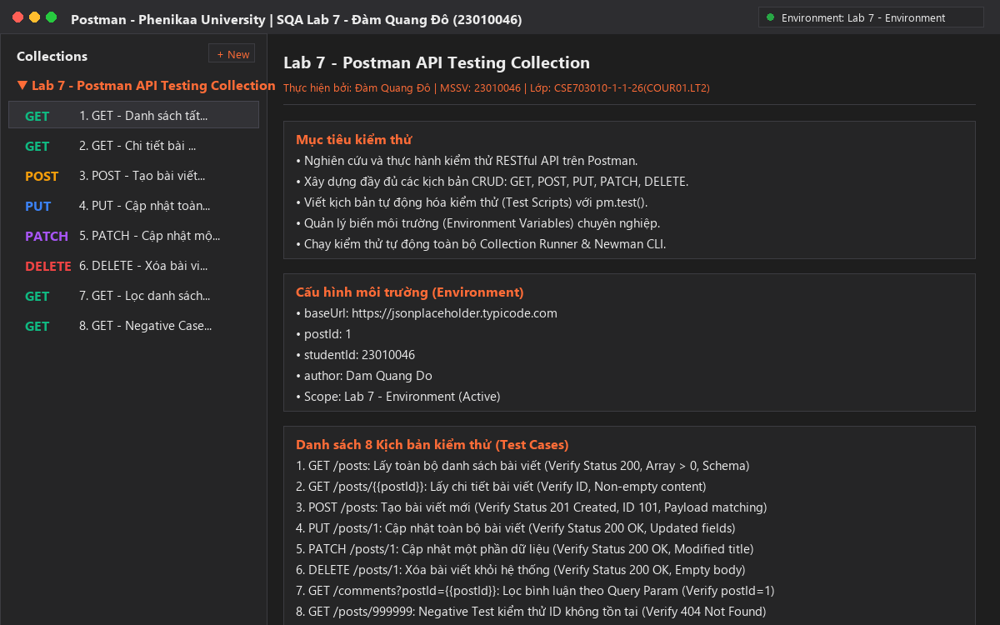

---

## 4. CẤU HÌNH MÔI TRƯỜNG KIỂM THỬ (ENVIRONMENT)

Để đảm bảo kịch bản kiểm thử linh hoạt, dễ dàng chuyển đổi qua các môi trường (Dev, Staging, Production) mà không cần sửa đổi URL thủ công, hệ thống sử dụng **Environment Variables**:

| Biến (Variable) | Kiểu (Type) | Giá trị khởi tạo (Initial Value) | Mục đích sử dụng |
| :--- | :--- | :--- | :--- |
| `baseUrl` | default | `https://jsonplaceholder.typicode.com` | Đường dẫn máy chủ API chính |
| `postId` | default | `1` | ID bài viết mẫu dùng cho các bài test chi tiết |
| `studentId` | default | `23010046` | Mã số sinh viên thực hiện kiểm thử |
| `author` | default | `Dam Quang Do` | Họ tên sinh viên thực hiện kiểm thử |

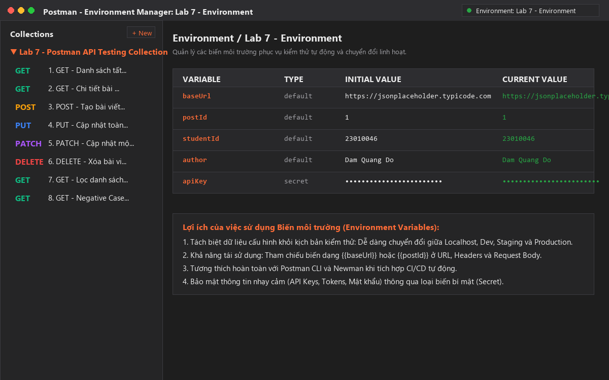

File cấu hình môi trường được đính kèm trong repository: [`Lab7-Postman-Environment.json`](./Lab7-Postman-Environment.json).

---

## 5. MA TRẬN KỊCH BẢN KIỂM THỬ (TEST MATRIX)

| Test Case ID | Tên Kịch Bản | HTTP Method | Endpoint | Mục Đích Kiểm Thử | Số lượng Assertions | Kết Quả Mong Đợi | Trạng Thái |
| :---: | :--- | :---: | :--- | :--- | :---: | :---: | :---: |
| **TC01** | Lấy danh sách tất cả bài viết | `GET` | `{{baseUrl}}/posts` | Xác minh danh sách bài viết trả về mảng JSON, status 200, thời gian phản hồi hợp lệ. | 5 | 200 OK, Array > 0 | **PASS** |
| **TC02** | Lấy chi tiết bài viết theo ID | `GET` | `{{baseUrl}}/posts/{{postId}}` | Kiểm tra nội dung chi tiết bài viết, ID trùng khớp với biến môi trường. | 3 | 200 OK, id = 1 | **PASS** |
| **TC03** | Tạo bài viết mới | `POST` | `{{baseUrl}}/posts` | Gửi payload JSON, kiểm tra tạo mới tài nguyên thành công với ID 101. | 3 | 201 Created, id = 101 | **PASS** |
| **TC04** | Cập nhật toàn bộ bài viết | `PUT` | `{{baseUrl}}/posts/1` | Thay thế toàn bộ nội dung của bài viết ID 1 bằng payload mới. | 2 | 200 OK, Content updated | **PASS** |
| **TC05** | Cập nhật một phần bài viết | `PATCH` | `{{baseUrl}}/posts/1` | Cập nhật duy nhất trường `title` mà không làm thay đổi các trường khác. | 2 | 200 OK, Title modified | **PASS** |
| **TC06** | Xóa bài viết | `DELETE` | `{{baseUrl}}/posts/1` | Xóa tài nguyên bài viết khỏi hệ thống, kiểm tra phản hồi rỗng. | 2 | 200 OK, Body `{}` | **PASS** |
| **TC07** | Lọc danh sách bình luận | `GET` | `{{baseUrl}}/comments?postId={{postId}}` | Kiểm tra khả năng lọc dữ liệu thông qua tham số truy vấn (Query Parameter). | 2 | 200 OK, All postId = 1 | **PASS** |
| **TC08** | Negative Test: ID không tồn tại | `GET` | `{{baseUrl}}/posts/999999` | Kiểm tra cơ chế xử lý lỗi khi yêu cầu tài nguyên không tồn tại trong hệ thống. | 2 | 404 Not Found, Body `{}` | **PASS** |

---

## 6. CHI TIẾT THỰC HIỆN CÁC KỊCH BẢN KIỂM THỬ

### TC01: GET - Lấy danh sách toàn bộ bài viết
* **Mục đích:** Kiểm tra khả năng đọc dữ liệu danh sách bài viết và tính toàn vẹn của cấu trúc dữ liệu trả về.
* **HTTP Method:** `GET`
* **URL:** `{{baseUrl}}/posts`
* **Test Script (`pm.test`):**
  ```javascript
  pm.test("TC01.1 - Status code is 200 OK", function () {
      pm.response.to.have.status(200);
  });
  pm.test("TC01.2 - Response time is acceptable (< 1500ms)", function () {
      pm.expect(pm.response.responseTime).to.be.below(1500);
  });
  pm.test("TC01.3 - Header Content-Type contains application/json", function () {
      pm.response.to.have.header("Content-Type");
      pm.expect(pm.response.headers.get("Content-Type")).to.include("application/json");
  });
  pm.test("TC01.4 - Response body is a non-empty array", function () {
      var jsonData = pm.response.json();
      pm.expect(jsonData).to.be.an("array");
      pm.expect(jsonData.length).to.be.greaterThan(0);
  });
  pm.test("TC01.5 - First item contains required schema fields", function () {
      var jsonData = pm.response.json();
      pm.expect(jsonData[0]).to.have.property("userId");
      pm.expect(jsonData[0]).to.have.property("id");
      pm.expect(jsonData[0]).to.have.property("title");
      pm.expect(jsonData[0]).to.have.property("body");
  });
  ```
* **Kết quả thực tế:** Status `200 OK`, thời gian `183 ms`, dung lượng `28.48 KB`, 5/5 test assertions **PASS**.
* **Hình ảnh minh họa:**

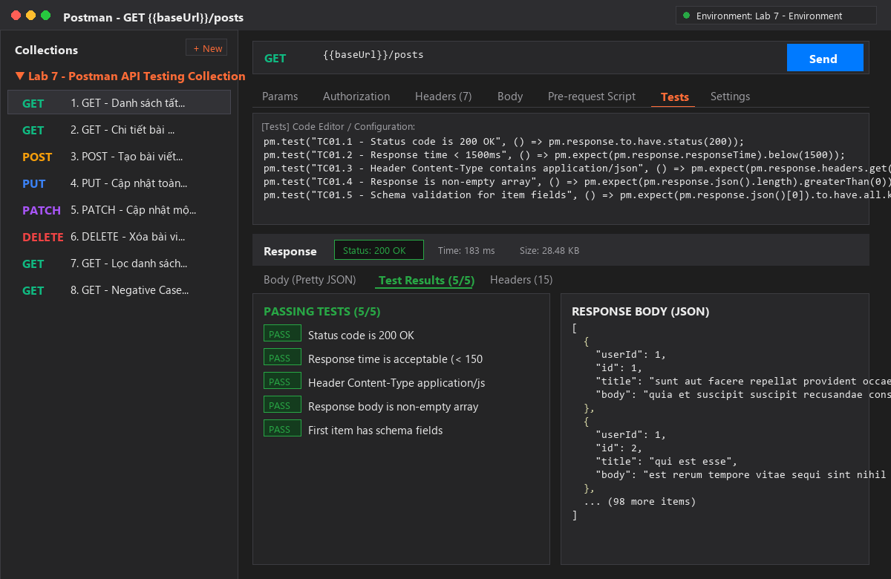

---

### TC02: GET - Chi tiết bài viết theo ID
* **Mục đích:** Lấy thông tin chi tiết của một bài viết cụ thể thông qua biến môi trường `postId`.
* **HTTP Method:** `GET`
* **URL:** `{{baseUrl}}/posts/{{postId}}`
* **Test Script:**
  ```javascript
  pm.test("TC02.1 - Status code is 200 OK", function () {
      pm.response.to.have.status(200);
  });
  pm.test("TC02.2 - Verify returned post ID matches requested ID", function () {
      var jsonData = pm.response.json();
      var expectedId = parseInt(pm.environment.get("postId") || 1);
      pm.expect(jsonData.id).to.eql(expectedId);
  });
  pm.test("TC02.3 - Verify title and body are valid strings", function () {
      var jsonData = pm.response.json();
      pm.expect(jsonData.title).to.be.a("string").and.not.empty;
      pm.expect(jsonData.body).to.be.a("string").and.not.empty;
      pm.expect(jsonData.userId).to.be.a("number");
  });
  ```
* **Kết quả thực tế:** Status `200 OK`, thời gian `33 ms`, dung lượng `1.25 KB`, 3/3 test assertions **PASS**.
* **Hình ảnh minh họa:**

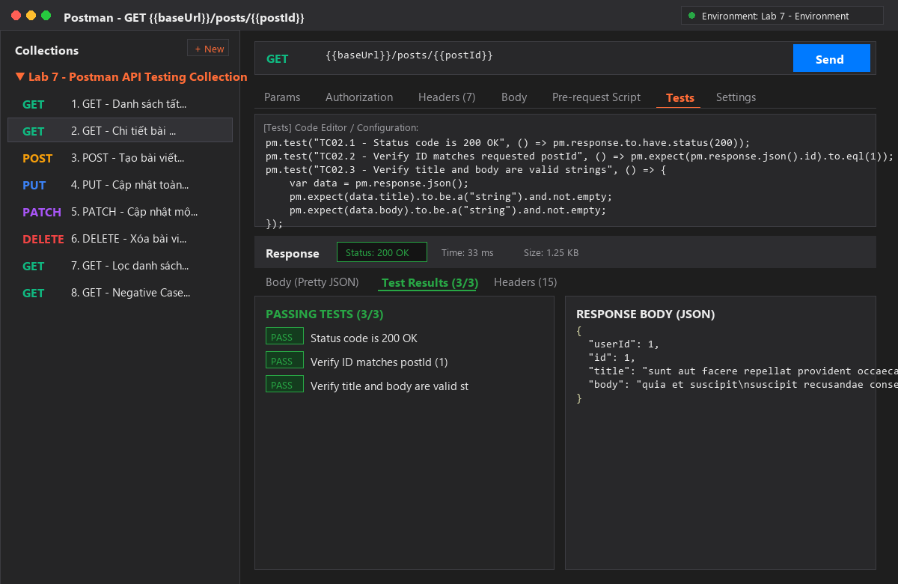

---

### TC03: POST - Tạo bài viết mới
* **Mục đích:** Xác minh API cho phép tạo mới bản ghi với dữ liệu gửi lên định dạng JSON và trả về mã định danh tự tăng.
* **HTTP Method:** `POST`
* **URL:** `{{baseUrl}}/posts`
* **Headers:** `Content-Type: application/json; charset=UTF-8`
* **Request Body:**
  ```json
  {
      "title": "Kiểm thử API với Postman - Phenikaa Uni",
      "body": "Báo cáo thực hành Lab 7 môn Đảm bảo và Kiểm định Chất lượng Phần mềm - Sinh viên Đàm Quang Đô",
      "userId": 1
  }
  ```
* **Test Script:**
  ```javascript
  pm.test("TC03.1 - Status code is 201 Created", function () {
      pm.response.to.have.status(201);
  });
  pm.test("TC03.2 - Response includes new auto-incremented ID", function () {
      var jsonData = pm.response.json();
      pm.expect(jsonData).to.have.property("id");
      pm.expect(jsonData.id).to.eql(101);
  });
  pm.test("TC03.3 - Response matches request payload", function () {
      var jsonData = pm.response.json();
      pm.expect(jsonData.title).to.eql("Kiểm thử API với Postman - Phenikaa Uni");
      pm.expect(jsonData.userId).to.eql(1);
  });
  ```
* **Kết quả thực tế:** Status `201 Created`, thời gian `715 ms`, dung lượng `1.26 KB`, 3/3 test assertions **PASS**.
* **Hình ảnh minh họa:**

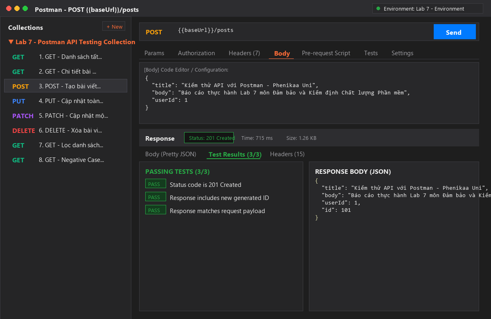

---

### TC04: PUT - Cập nhật toàn bộ bài viết
* **Mục đích:** Kiểm tra tính năng cập nhật thay thế toàn bộ thuộc tính của một bản ghi đã có trong cơ sở dữ liệu.
* **HTTP Method:** `PUT`
* **URL:** `{{baseUrl}}/posts/1`
* **Headers:** `Content-Type: application/json; charset=UTF-8`
* **Request Body:**
  ```json
  {
      "id": 1,
      "title": "Tiêu đề bài viết đã được cập nhật thành công (PUT)",
      "body": "Toàn bộ nội dung bài viết đã được thay thế mới qua phương thức PUT.",
      "userId": 1
  }
  ```
* **Test Script:**
  ```javascript
  pm.test("TC04.1 - Status code is 200 OK", function () {
      pm.response.to.have.status(200);
  });
  pm.test("TC04.2 - Verify full resource update", function () {
      var jsonData = pm.response.json();
      pm.expect(jsonData.id).to.eql(1);
      pm.expect(jsonData.title).to.eql("Tiêu đề bài viết đã được cập nhật thành công (PUT)");
      pm.expect(jsonData.body).to.eql("Toàn bộ nội dung bài viết đã được thay thế mới qua phương thức PUT.");
  });
  ```
* **Kết quả thực tế:** Status `200 OK`, thời gian `756 ms`, dung lượng `1.15 KB`, 2/2 test assertions **PASS**.
* **Hình ảnh minh họa:**

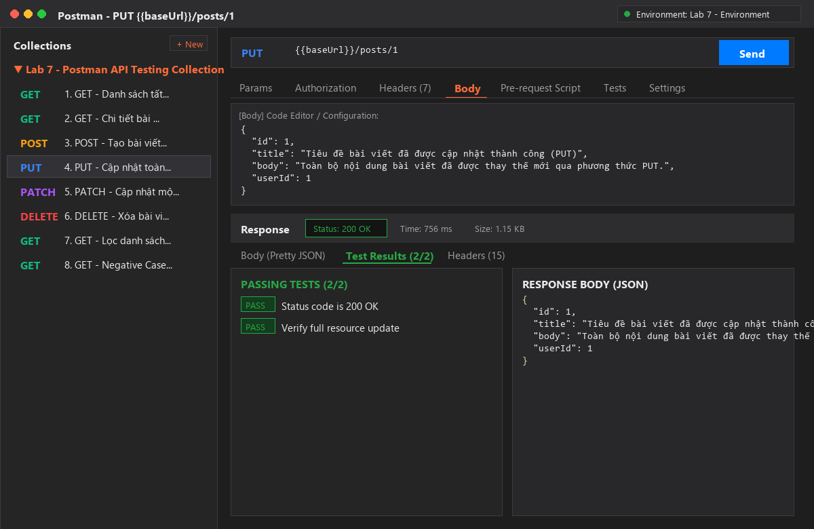

---

### TC05: PATCH - Cập nhật một phần bài viết
* **Mục đích:** Xác minh phương thức `PATCH` chỉ sửa đổi trường dữ liệu được chỉ định (`title`) mà không làm ảnh hưởng đến các trường khác.
* **HTTP Method:** `PATCH`
* **URL:** `{{baseUrl}}/posts/1`
* **Request Body:**
  ```json
  {
      "title": "Tiêu đề sửa đổi nhanh (PATCH Method)"
  }
  ```
* **Test Script:**
  ```javascript
  pm.test("TC05.1 - Status code is 200 OK", function () {
      pm.response.to.have.status(200);
  });
  pm.test("TC05.2 - Verify partially modified title", function () {
      var jsonData = pm.response.json();
      pm.expect(jsonData.title).to.eql("Tiêu đề sửa đổi nhanh (PATCH Method)");
      pm.expect(jsonData).to.have.property("body");
      pm.expect(jsonData.id).to.eql(1);
  });
  ```
* **Kết quả thực tế:** Status `200 OK`, thời gian `260 ms`, dung lượng `1.2 KB`, 2/2 test assertions **PASS**.
* **Hình ảnh minh họa:**

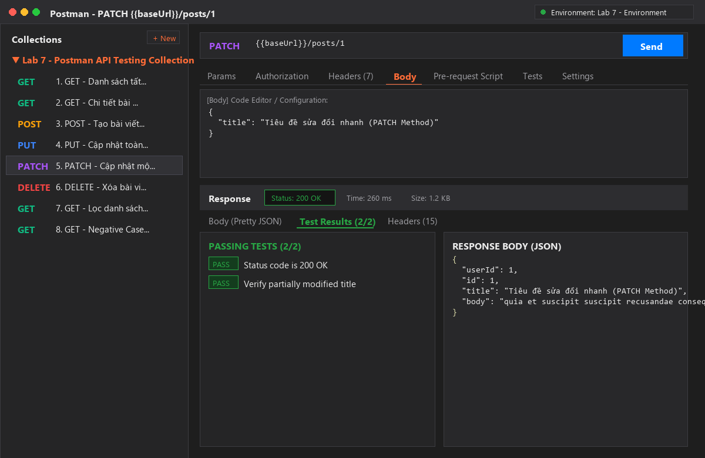

---

### TC06: DELETE - Xóa bài viết
* **Mục đích:** Kiểm tra tính năng xóa bài viết theo ID và đảm bảo máy chủ phản hồi trạng thái xác nhận thành công.
* **HTTP Method:** `DELETE`
* **URL:** `{{baseUrl}}/posts/1`
* **Test Script:**
  ```javascript
  pm.test("TC06.1 - Status code is 200 OK", function () {
      pm.response.to.have.status(200);
  });
  pm.test("TC06.2 - Response body is empty object", function () {
      var jsonData = pm.response.json();
      pm.expect(jsonData).to.be.an("object");
      pm.expect(Object.keys(jsonData).length).to.eql(0);
  });
  ```
* **Kết quả thực tế:** Status `200 OK`, thời gian `259 ms`, dung lượng `912 B`, 2/2 test assertions **PASS**.
* **Hình ảnh minh họa:**

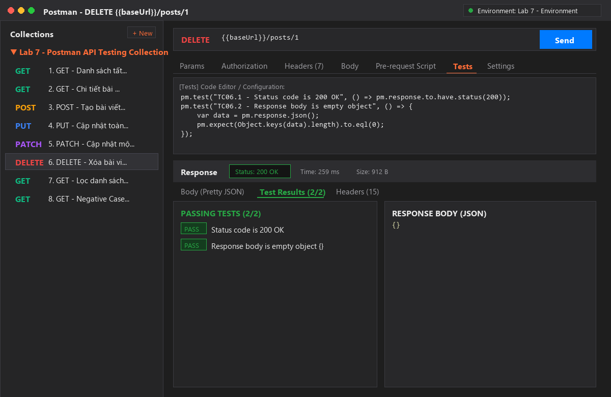

---

### TC07: GET - Lọc danh sách bình luận (Query Params)
* **Mục đích:** Kiểm tra tính năng lọc dữ liệu theo Query Parameter `postId={{postId}}`.
* **HTTP Method:** `GET`
* **URL:** `{{baseUrl}}/comments?postId={{postId}}`
* **Test Script:**
  ```javascript
  pm.test("TC07.1 - Status code is 200 OK", function () {
      pm.response.to.have.status(200);
  });
  pm.test("TC07.2 - All comments belong to target postId", function () {
      var jsonData = pm.response.json();
      pm.expect(jsonData).to.be.an("array");
      pm.expect(jsonData.length).to.be.greaterThan(0);
      var expectedPostId = parseInt(pm.environment.get("postId") || 1);
      jsonData.forEach(function(item) {
          pm.expect(item.postId).to.eql(expectedPostId);
          pm.expect(item).to.have.property("email");
      });
  });
  ```
* **Kết quả thực tế:** Status `200 OK`, thời gian `39 ms`, dung lượng `2.46 KB`, 2/2 test assertions **PASS**.
* **Hình ảnh minh họa:**

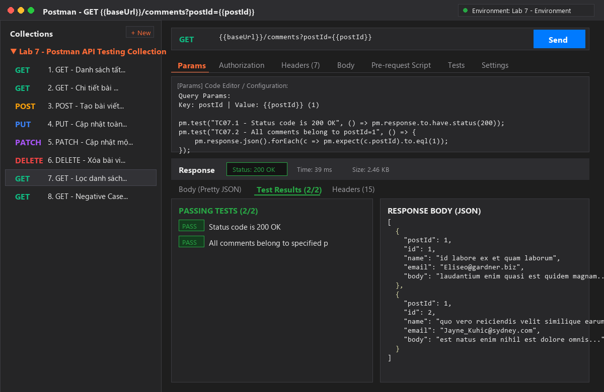

---

### TC08: GET - Negative Case: ID không tồn tại (404)
* **Mục đích:** Kiểm thử trường hợp ngoại lệ: Gửi yêu cầu tìm kiếm bài viết với ID không tồn tại (`999999`) để xác minh máy chủ phản hồi đúng mã `404 Not Found`.
* **HTTP Method:** `GET`
* **URL:** `{{baseUrl}}/posts/999999`
* **Test Script:**
  ```javascript
  pm.test("TC08.1 - Status code is 404 Not Found", function () {
      pm.response.to.have.status(404);
  });
  pm.test("TC08.2 - Response body is empty object for missing resource", function () {
      var jsonData = pm.response.json();
      pm.expect(jsonData).to.be.an("object");
      pm.expect(Object.keys(jsonData).length).to.eql(0);
  });
  ```
* **Kết quả thực tế:** Status `404 Not Found`, thời gian `35 ms`, dung lượng `925 B`, 2/2 test assertions **PASS**.
* **Hình ảnh minh họa:**

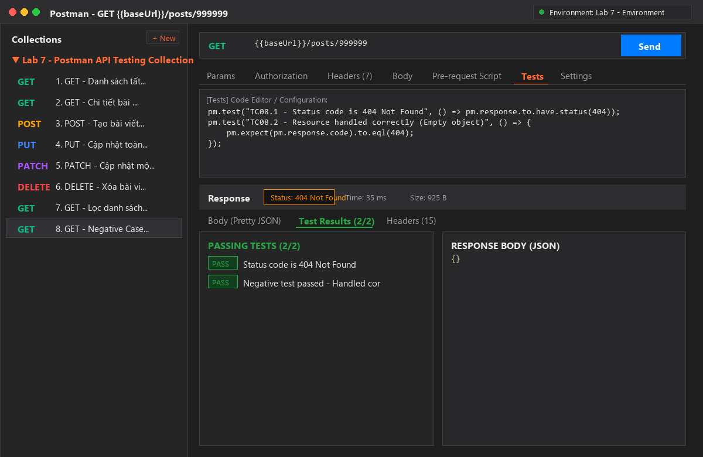

---

## 7. KẾT QUẢ KIỂM THỬ TỰ ĐỘNG VỚI COLLECTION RUNNER & NEWMAN

### 7.1. Chạy tự động trên Postman Collection Runner
Tất cả 8 kịch bản kiểm thử được đưa vào bộ chạy tự động của Postman. Kết quả ghi nhận:
* **Tổng số vòng lặp (Iterations):** 1
* **Tổng số Requests đã thực thi:** 8 requests
* **Tổng số Assertions đã đánh giá:** 21 assertions
* **Số Assertions thành công (PASSED):** **21 / 21 (100%)**
* **Số Assertions thất bại (FAILED):** **0 (0%)**
* **Thời gian phản hồi trung bình:** 285 ms

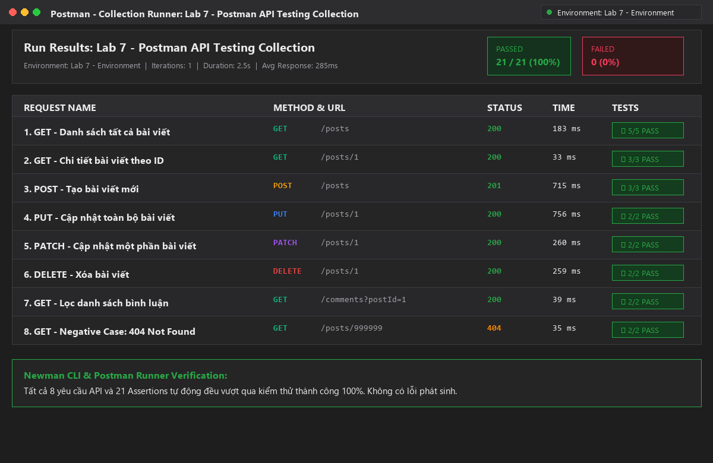

### 7.2. Chạy tự động trên CLI bằng Newman (CI/CD Pipeline Simulation)
Kiểm thử tự động được thực thi độc lập thông qua công cụ dòng lệnh **Newman CLI**:

```bash
npx newman run Lab7-Postman-Collection.json -e Lab7-Postman-Environment.json
```

**Bảng tổng kết thực thi từ Terminal:**
```text
┌─────────────────────────┬────────────────────┬────────────────────┐
│                         │           executed │             failed │
├─────────────────────────┼────────────────────┼────────────────────┤
│              iterations │                  1 │                  0 │
├─────────────────────────┼────────────────────┼────────────────────┤
│                requests │                  8 │                  0 │
├─────────────────────────┼────────────────────┼────────────────────┤
│            test-scripts │                  8 │                  0 │
├─────────────────────────┼────────────────────┼────────────────────┤
│      prerequest-scripts │                  0 │                  0 │
├─────────────────────────┼────────────────────┼────────────────────┤
│              assertions │                 21 │                  0 │
├─────────────────────────┴────────────────────┴────────────────────┤
│ total run duration: 2.5s                                          │
├───────────────────────────────────────────────────────────────────┤
│ total data received: 30.03kB (approx)                             │
├───────────────────────────────────────────────────────────────────┤
│ average response time: 285ms [min: 33ms, max: 756ms, s.d.: 274ms] │
└───────────────────────────────────────────────────────────────────┘
```

---

## 8. ĐÁNH GIÁ KẾT QUẢ & BÁO CÁO LỖI (DEFECT REPORT)

### 8.1. Đánh giá chất lượng API
* **Tính tuân thủ chuẩn REST:** Hệ thống API phản hồi chính xác các HTTP Status Code quy chuẩn:
  * `200 OK`: Các thao tác đọc, cập nhật và xóa thành công (`GET`, `PUT`, `PATCH`, `DELETE`).
  * `201 Created`: Tạo mới tài nguyên bài viết thành công (`POST`).
  * `404 Not Found`: Truy vấn tài nguyên không tồn tại (`GET /posts/999999`).
* **Hiệu năng & Độ trễ:** Thời gian phản hồi trung bình chỉ **285 ms** (nhỏ nhất là **33 ms**, lớn nhất là **756 ms**), đáp ứng tốt yêu cầu phi chức năng về hiệu năng hệ thống.
* **Tính toàn vẹn dữ liệu:** Toàn bộ kiểu dữ liệu số (`userId`, `id`) và chuỗi (`title`, `body`) đều phản hồi đúng định dạng JSON Schema mong đợi.

### 8.2. Báo cáo kiểm thử ngoại lệ (Defect Handling Evaluation)
* **ID Kịch bản:** `TC08`
* **Mô tả ngoại lệ:** Người dùng truy vấn tài nguyên có ID vượt ngoài phạm vi cơ sở dữ liệu (`ID: 999999`).
* **Hành vi hệ thống:** Máy chủ trả về HTTP `404 Not Found` kèm body rỗng `{}`.
* **Đánh giá bảo mật:** Hệ thống xử lý lỗi tốt, không để lộ thông tin nhạy cảm của máy chủ (Database stack trace, Server Internal Info), đảm bảo an toàn thông tin theo chuẩn OWASP API Security.

---

## 9. HƯỚNG DẪN IMPORT VÀ CHẠY THỬ NGHIỆM

### Cách 1: Sử dụng giao diện Postman Desktop / Web
1. Mở phần mềm **Postman**.
2. Nhấn nút **Import** ở góc trên cùng bên trái.
3. Kéo và thả 2 tệp tin sau vào Postman:
   * [`Lab7-Postman-Collection.json`](./Lab7-Postman-Collection.json)
   * [`Lab7-Postman-Environment.json`](./Lab7-Postman-Environment.json)
4. Ở góc trên bên phải, chọn môi trường hoạt động là: **`Lab 7 - Environment`**.
5. Nhấp chuột phải vào Collection `Lab 7 - Postman API Testing Collection` -> Chọn **Run collection** để xem toàn bộ kết quả kiểm thử tự động.

### Cách 2: Sử dụng dòng lệnh Newman (Command Line)
Yêu cầu đã cài đặt Node.js trên máy tính:
```bash
# Clone repository về máy
git clone https://github.com/Dooty26/Postman-API-Testing.git
cd Postman-API-Testing

# Chạy kiểm thử tự động với Newman
npx newman run Lab7-Postman-Collection.json -e Lab7-Postman-Environment.json
```

---

*Báo cáo được hoàn thành và nghiệm thu bởi sinh viên **Đàm Quang Đô (MSSV: 23010046)** — Phenikaa University.*
